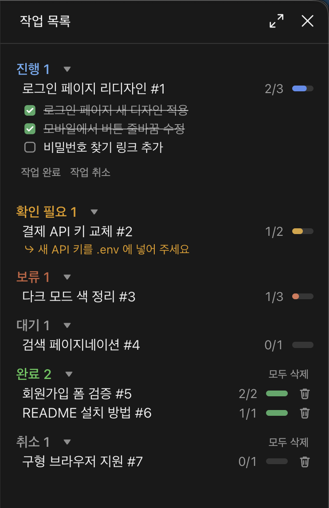
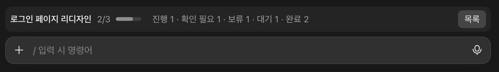
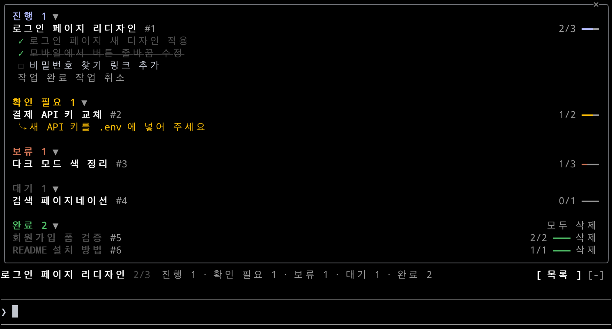

# task-tracker

한 세션에서 Claude 에게 시킨 작업이 여러 개 쌓일 때, 무엇을 시켰고 각각 어디까지 왔는지 보여 주는 Claude Code 플러그인.



## 설치

터미널의 Claude Code 프롬프트에서:

```
/plugin install task-tracker --marketplace jongjunpark/task-tracker
```

`Add marketplace?` 에 `y`, 범위는 user 를 고른다.

셸에서:

```bash
claude plugin install task-tracker --marketplace jongjunpark/task-tracker
```

데스크톱 앱(`/plugin` 이 안 되는 곳): 입력창 옆 + → Plugins → Add marketplace 에 `jongjunpark/task-tracker` → Add plugin.

플러그인 훅 모듈(mod)을 지원하는 Claude Code 버전이 필요하다.

## 동작

- 보낸 메시지는 훅이 바로 `m1`, `m2`… 로 기록한다. Claude 가 일하는 도중에 보낸 메시지도 포함한다.
- Claude 는 `tasks` 도구로 메시지를 새 작업(add), 기존 작업에 붙이기(attach), 작업 아님(ignore) 으로 분류하고, 처리한 메시지를 resolve 하며 상태를 갱신한다.
- 진행도 = 작업에 붙은 요청 중 처리된 수. 완료된 작업은 전부 처리된 것으로 본다.
- 상태: 진행 · 확인 필요 · 보류 · 대기 · 완료 · 취소. 진행은 한 번에 하나이고, 다른 작업을 진행으로 올리면 하던 작업은 보류가 된다.
- 확인 필요는 사람이 답하거나 해야 할 일이 있을 때만 쓰고, 그 할 일(`ask`)이 반드시 함께 있어야 한다. 그 작업에 다음 메시지가 붙으면 다시 진행으로 돌아간다.
- Claude 에게는 안 끝난 작업 전부와 최근 완료 3개를 자세히, 그보다 오래된 완료는 제목만 짧게 보낸다.

## 화면

- 채팅 옆 패널 「작업 목록」
  - 상태별 묶음(상태 색 제목 + 개수, 삼각형으로 접기)
  - 작업 제목을 누르면 요청 목록(체크박스, 처리된 요청은 취소선)이 펼쳐진다
  - 처리된 요청과 남은 요청이 섞여 있으면 처리된 요청은 「처리됨 N개」 한 줄로 접히고, 누르면 펼쳐진다
  - 제목 줄 오른쪽에 `처리/전체` 숫자와 진행 막대
  - 확인 필요 작업은 제목 아래에 `⤷ 할 일` 을 표시
  - 안 끝난 작업에는 「작업 완료」·「작업 취소」 버튼
  - 완료·취소 묶음에는 「모두 삭제」, 끝난 작업 줄마다 휴지통(하나만 삭제)
- 프롬프트 위 한 줄: 진행 중 작업 제목, 진행 막대, 상태별 개수, [목록] 버튼

  

- 터미널에서는 그림 대신 글자로 그린다.

  

## 명령

- `/task-tracker` — 패널 열기
- `/task-tracker done <번호>` · `/task-tracker drop <번호>` — 완료 · 취소 처리
- `/task-tracker clear` — 완료·취소된 작업 정리
- `/task-tracker reset` — 목록 비우기

## 개발

```bash
claude plugin validate .
claude plugin test .
```
